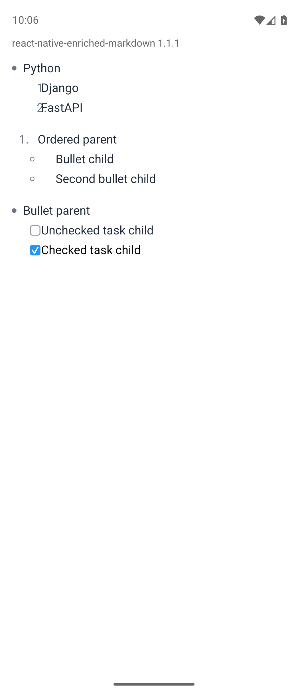

# Android draws mixed nested list markers over their text

Observed with `react-native-enriched-markdown` 1.1.1 on Android API 36 (Pixel 9
emulator). iOS 26.5 renders the same Markdown correctly.

On Android, a nested list whose marker type differs from its parent's gets the
wrong space between marker and text:

- numbers under a bullet are drawn over their item text (`1Django`),
- checkboxes under a bullet touch their text,
- bullets under a short number sit far from their text.

## Run

```bash
npm ci
./repro.sh android
./repro.sh ios       # reference: correct rendering
```

## Expected

Every nested marker keeps the usual gap before its text, as on iOS.

## Actual

| Android | iOS (reference) |
| --- | --- |
|  |  |
