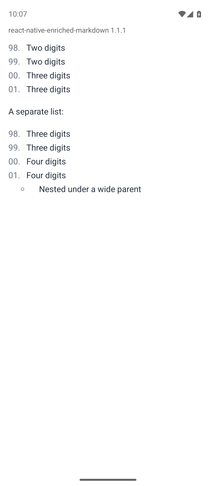
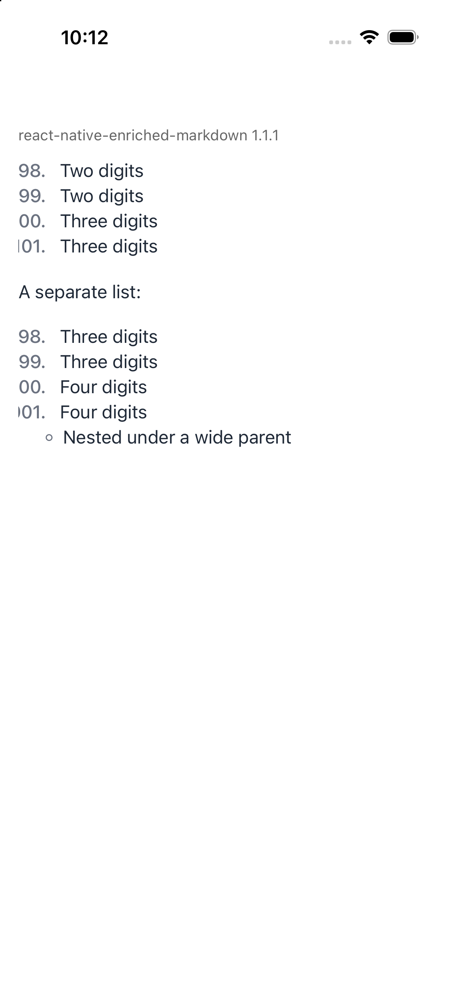

# Ordered list markers wider than `99.` are clipped

Observed with `react-native-enriched-markdown` 1.1.1 on Android API 36 (Pixel 9
emulator) and iOS 26.5 (iPhone 17 Simulator).

The marker column of an ordered list is sized to fit `99.`, and each number is
right-aligned against it. A list that reaches `100.` draws its wider markers past the
column's leading edge, where they lose their first digits: `100.` shows as `00.` and
`998.` as `98.`.

## Run

```bash
npm ci
./repro.sh android
./repro.sh ios
```

## Expected

Every marker is complete, and the item text moves right far enough to fit the
widest number in the list.

## Actual

| Android | iOS |
| --- | --- |
|  |  |
